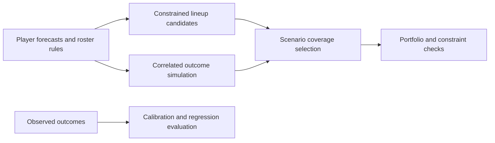

# Daily Fantasy Sports — Quantitative Research Portfolio

A public quantitative research portfolio drawn from a historical daily fantasy sports system. Its central question is how to turn uncertain, correlated player forecasts into a constrained portfolio of lineups—and how to evaluate that process without confusing simulated outcomes with observed performance.

The project grew into a research-to-application system spanning data ingestion, forecast combination, uncertainty modeling, lineup optimization, evaluation, and a web dashboard. Baseball is the most developed example in this release; golf adds regularized signal combination, while basketball and football provide additional roster and scoring implementations.

For quantitative research and data science recruiters, the useful question is how the code connects **statistical assumptions to decision-making under constraints**. The code tour below points to that work directly. This is a project portfolio, not a claim of independently verified trading or betting performance.

This repository is a curated source release. Examples use synthetic data; private account records, credentials, paid-source datasets, and deployment state are excluded. The original DFS/Holmes operation was retired on September 5, 2026.

## Run the research example

Use Python 3.12 from the repository root:

```bash
git clone https://github.com/Kobejo32/Daily-Fantasy-Sports.git
cd Daily-Fantasy-Sports
python3 -m venv .venv
source .venv/bin/activate
python -m pip install -r requirements.txt
OPENBLAS_NUM_THREADS=1 python examples/synthetic_research.py
python scripts/verify.py
```

On Windows, activate with `.venv\Scripts\Activate.ps1` and run `python examples/synthetic_research.py` without the environment-variable prefix.

The [example](examples/synthetic_research.py) creates **36 fictional players and 48 feasible candidate rosters**, selects a five-lineup portfolio using 3,000 correlated draws, then evaluates it on 5,000 fresh draws from the same simulator. It checks roster slots, salary budgets, team caps, pitcher concentration, and lineup overlap. A projection-ranked baseline uses the same portfolio constraints. It makes no network calls and needs no account or data subscription.

The [captured output](docs/demo-output.txt) shows the result for a fixed seed. Fresh simulator draws test the selection procedure inside an assumed model; they are **not historical out-of-sample observations**. Synthetic score units are generic; the example combines archived FanDuel roster rules with the simulator's zero-floor convention and is not a platform scoring replication.

Verified for this release: **184 offline Python tests and 28 isolated web tests pass**. See [verification details](docs/PUBLIC_RELEASE.md).

## What to review first

| Engineering problem | Implementation | Why it matters |
| --- | --- | --- |
| Model players who share a game environment | [`mlb/src/portfolio/joint_sim.py`](mlb/src/portfolio/joint_sim.py) and [`mlb/src/correlation/priors.py`](mlb/src/correlation/priors.py) | A Gaussian copula combines structural correlation assumptions with empirical residual distributions. Eigenvalue clipping repairs the correlation matrix before sampling. |
| Select portfolios with complementary outcomes | [`mlb/src/portfolio/coverage_builder.py`](mlb/src/portfolio/coverage_builder.py) | Greedy selection rewards each lineup's additional coverage of simulated outcomes, with optional pitcher, team, ownership, and overlap limits. |
| Detect degraded model behavior | [`mlb/src/calibration/metrics.py`](mlb/src/calibration/metrics.py) and [`mlb/src/calibration/gate.py`](mlb/src/calibration/gate.py) | Brier score, log loss, reliability curves, and baseline-relative checks separate calibration quality from raw projected points. |
| Respect forecast timing and reconcile outcomes | [`mlb/src/calibration/resolve.py`](mlb/src/calibration/resolve.py) | Selects the latest eligible forecast at or before contest lock and records whether an outcome was matched by player ID, normalized name, or remained unresolved. |
| Combine correlated and incomplete forecast sources | [`pga/src/signals/engine.py`](pga/src/signals/engine.py) and [`independence.py`](pga/src/signals/independence.py) | ElasticNet-derived source weights, evidence-size fallbacks, missing-source renormalization, and residual signal analysis. |
| Assign athletes to eligible roster slots within a budget | [`mlb/src/optimizer/fd_cash.py`](mlb/src/optimizer/fd_cash.py) | Binary decision variables represent player-to-slot assignments, so multi-position eligibility remains available to the solver. Salary, roster, and team constraints are enforced together. |

## Architecture



The algorithms accept explicit data structures and arrays. Data ingestion and account integrations belonged to the original operational system; the public examples exercise the computational core independently.

## Background and work represented

Daily fantasy sports offers a concrete constrained-decision problem: choose a valid roster under a salary budget while forecasts are noisy, players share game-level risks, and the payout objective can reward different parts of the outcome distribution. Maximizing expected points alone does not answer every portfolio question.

The project explores the whole research loop: define the objective, reconcile inputs, represent uncertainty, generate feasible candidates, select a portfolio, and evaluate forecasts against outcomes. The public release exposes the computational work and selected application code; it leaves private operational records and third-party datasets out of the review process.

Development used AI coding assistants. The value of this portfolio should be assessed through the research choices, implementation, reproducible examples, and stated limitations rather than an assumption of manual authorship of every line.

## Technical stack

- **Python** for numerical modeling and orchestration.
- **PuLP / CBC** for mixed-integer roster optimization.
- **NumPy, SciPy, and pandas** for simulation, residual distributions, and evaluation.
- **scikit-learn** for regularized forecast combination.
- **pytest** for synthetic fixtures, boundary cases, and regression checks.
- **React / TypeScript / Next.js**, with Supabase/PostgreSQL and Stripe integration patterns, in the [web source reference](web/README.md). The original hosted application is not bundled as a deployable service.

## Research decisions worth inspecting

**A portfolio objective differs from a single-lineup objective.** The coverage builder chooses candidates based on outcomes not already covered by the selected portfolio. Its configurable limits make concentration and overlap explicit. These are heuristic portfolio choices, not a guarantee of realized returns.

**Simulation quality depends on assumptions and evidence.** The joint simulator keeps marginal residual behavior separate from dependence assumptions. It falls back to a Gaussian marginal when empirical samples are insufficient. Synthetic examples demonstrate mechanics; they do not validate the assumptions against live contests.

**Model evaluation includes confidence.** Calibration utilities compare predicted probabilities with realized outcomes and expose overconfidence. The regression gate compares metrics with a frozen baseline, rather than treating a model score alone as a release decision.

**Forecast timing is part of the experiment.** The snapshot selector excludes observations after contest lock and separates the relevant forecast source from parallel experimental runs. Outcome resolution prefers stable IDs and exposes fallback matches. These are components of a sound historical evaluation; a complete audit also requires the underlying snapshots and their collection history.

**Multi-position eligibility is an assignment problem.** Selecting a player and assigning a slot are related decisions. The FanDuel optimizer represents both explicitly, covering cases where collapsing a player to their first listed position would incorrectly make a lineup infeasible.

## Scope and limitations

- This is historical research and portfolio code, not an actively operated DFS service.
- Public examples and tests establish computational behavior; they do not establish a profitable betting strategy or out-of-sample predictive performance.
- The coverage objective measures performance against simulated thresholds. The default threshold is derived from the candidate lineup pool, which is a proxy for the contest field; model misspecification or an unrepresentative pool can distort that objective.
- The private system depended on external forecasts, historical snapshots, credentials, and hosted services that are not part of this release. Historical return claims are intentionally omitted because the supporting datasets are not included for independent reproduction.
- Rules and research assumptions reflect the archived implementation. Reusing it for current contests requires checking current platform rules and independently validating inputs and outputs.

## Repository guide

| Directory | Public scope |
| --- | --- |
| [`mlb/src`](mlb/src) | Simulation, correlation, calibration, optimization, and staged portfolio construction. |
| [`pga/src`](pga/src) | Golf forecast aggregation, signal evaluation, and optimization. |
| [`nba/src`](nba/src), [`nfl/src`](nfl/src) | Additional sport-specific scoring and roster construction. |
| [`shared`](shared) | Reusable odds, sizing, and portfolio-support utilities from the historical system. |
| [`examples`](examples) | Credential-free synthetic research demonstration. |
| [`web`](web/README.md) | Selected frontend, optimizer, permissions, and subscription source with isolated tests. |

The documented Python environment supports the demo and selected offline tests. Other retained modules are **historical reference code** and may require omitted data, artifacts, integrations, or additional dependencies. Tests run separately by sport because the historical modules share top-level import names. Network access is disabled for the Python test runs.

For the isolated web tests, run `npm ci --ignore-scripts` followed by `npm test` inside `web/`. See [release scope and verification](docs/PUBLIC_RELEASE.md) for the exact boundaries and checks.

## Provenance

Derived from the September 5, 2026 source archive of the DFS project. The public copy preserves selected computational modules while replacing operational setup with synthetic examples and reproducible verification instructions.
